# Diagramas — Autos Colombia

Versión en **Mermaid** de los diagramas del proyecto. GitHub y la vista previa
de Markdown de VS Code los dibujan directamente, así que sirven como evidencia
verificable en el repositorio y como guía para dibujarlos en StarUML.

El modelo de StarUML está en
[`../entrega-ingenieria-software/staruml/AutosColombia.mdj`](../entrega-ingenieria-software/staruml/AutosColombia.mdj);
cómo abrirlo y exportar las imágenes del PDF: [06-staruml.md](06-staruml.md).

> **StarUML 7 puede importar estos diagramas de secuencia directamente:** menú
> **Tools ▸ Generate Diagram by Mermaid…**, pega el bloque (sin las líneas ```) y se crea el
> diagrama. Los actores se escriben como `participant` porque esa importación no admite `actor`.

| # | Diagrama | Entregable | Sección |
| --- | --- | --- | --- |
| 1 | Casos de uso — gestión de usuarios y celdas (iteración 2) | B | [1](#1-casos-de-uso--gestión-de-usuarios-y-celdas-iteración-2) |
| 2 | Casos de uso — operación y pagos (iteración 1 y mensualidades) | B | [2](#2-casos-de-uso--operación-y-pagos) |
| 3 | Diagrama de clases (incluye Cliente y Pago) | Retroalimentación | [3](#3-diagrama-de-clases) |
| 4–10 | Diagramas de secuencia (iteraciones 1 y 2) | E | [4](#diagramas-de-secuencia) |
| 11 | Diagrama de componentes (iteraciones 1 y 2) | F | [11](#11-diagrama-de-componentes) |

## 1. Casos de uso — gestión de usuarios y celdas (iteración 2)

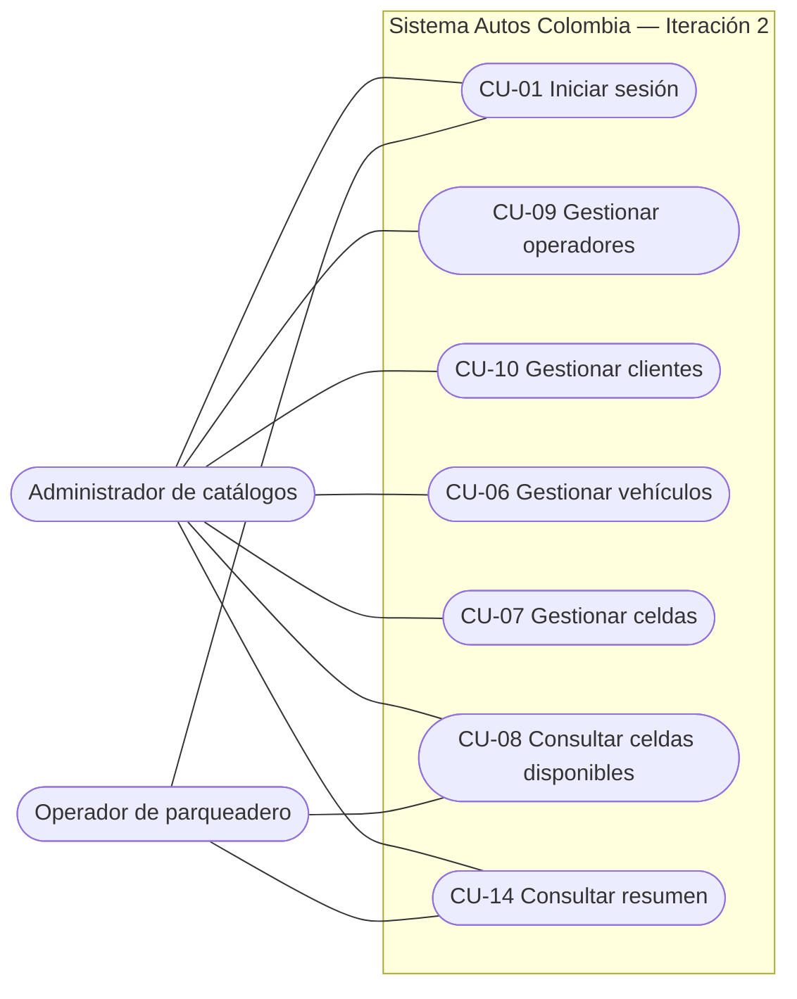

## 2. Casos de uso — operación y pagos

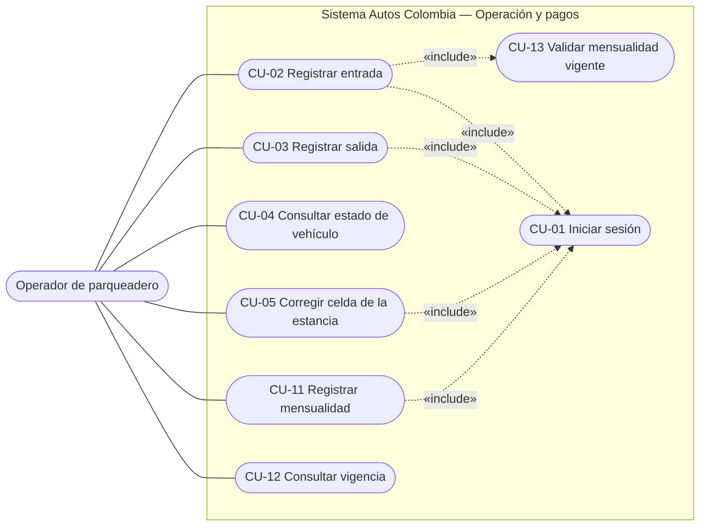

CU-15 *Verificar estado de la API* (`GET /health`) lo usa la pantalla de inicio.

## 3. Diagrama de clases

Incluye **Cliente** y **Pago** con sus relaciones, tal como pidió la
retroalimentación de la Actividad 1. Coincide con `backend/app/models.py`.

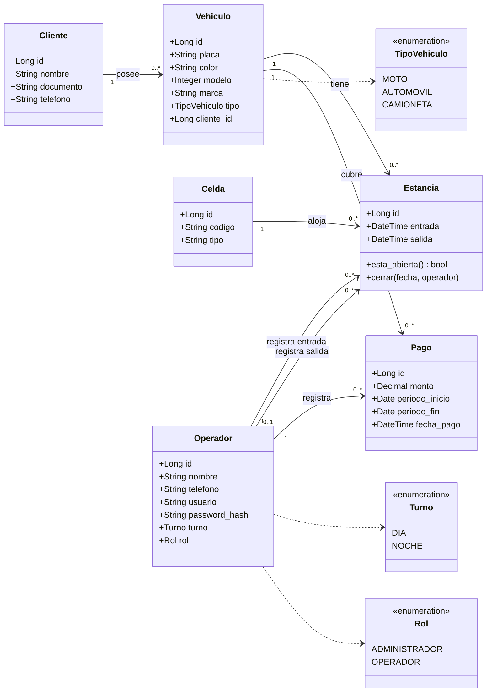

Reglas de la base de datos que el diagrama resume: una sola estancia abierta
por vehículo y por celda (índices únicos parciales); todas las claves foráneas
son `RESTRICT`; `modelo` se limita a 1900–2200 con la migración `0004`.

## Diagramas de secuencia

Participantes comunes: **Operador** (persona), **UI** (componente Angular),
**API** (router FastAPI), **Servicio** (capa `services`) y **BD** (PostgreSQL).

### 4. Iniciar sesión (RF-16)

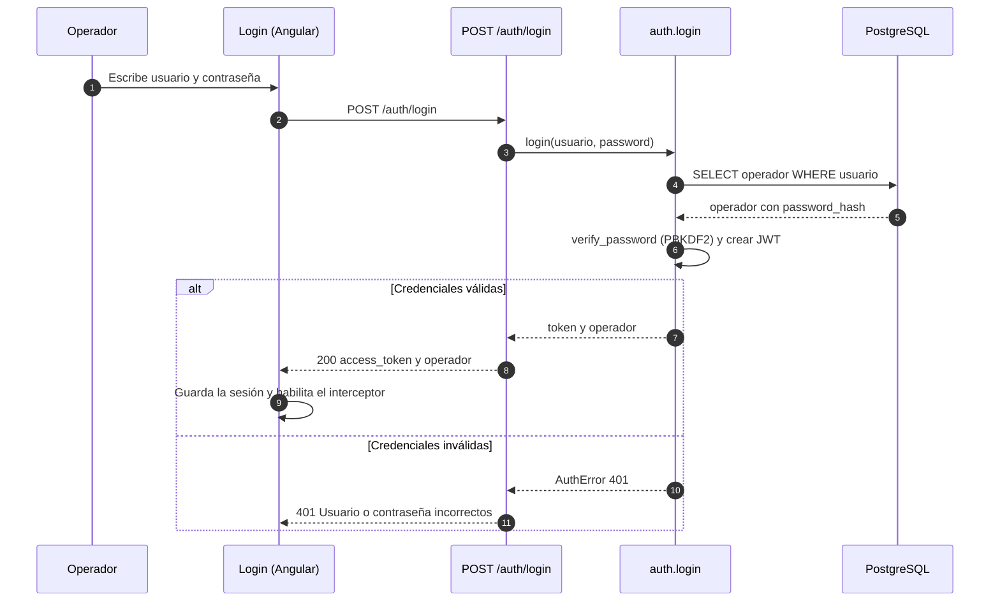

### 5. Registrar entrada de vehículo (RF-03, RF-14)

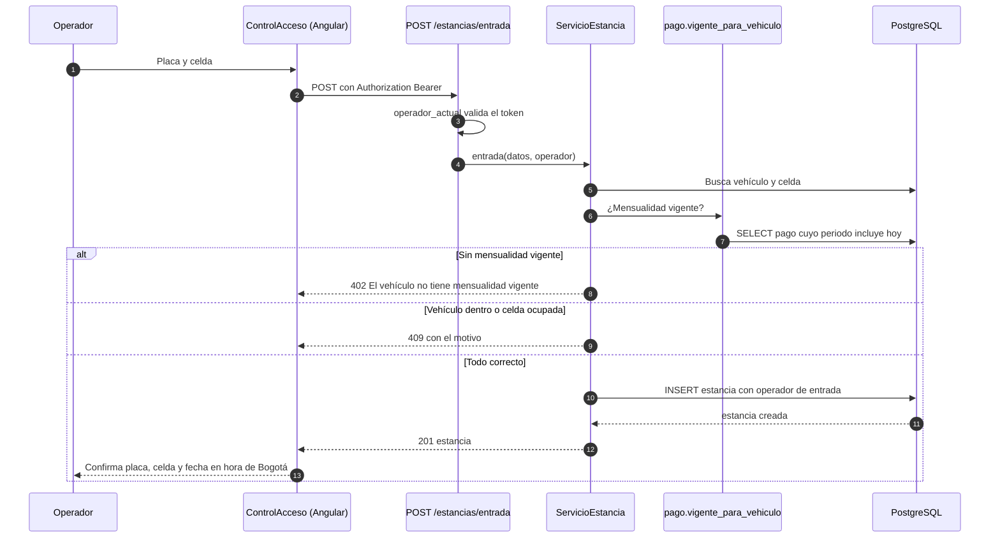

### 6. Registrar salida de vehículo (RF-04)

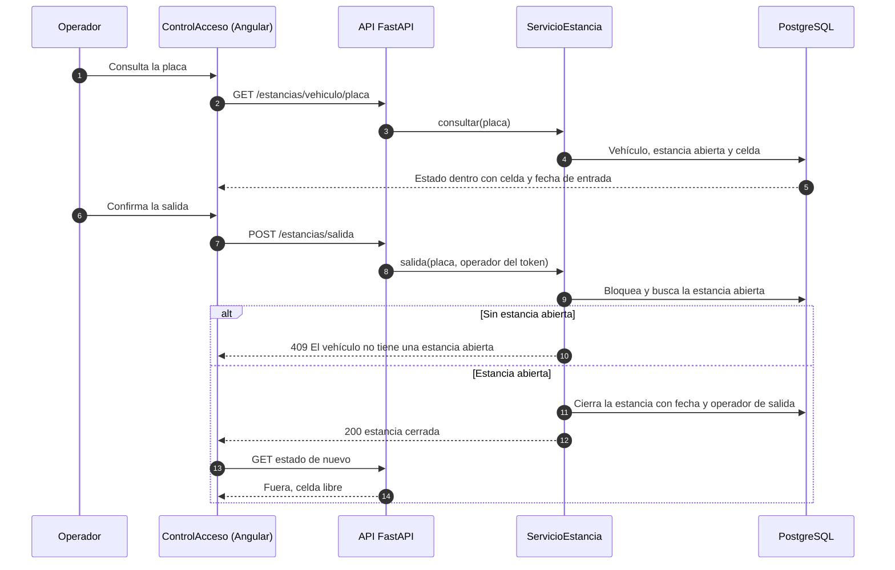

### 7. Gestionar operadores — crear (RF-07, iteración 2)

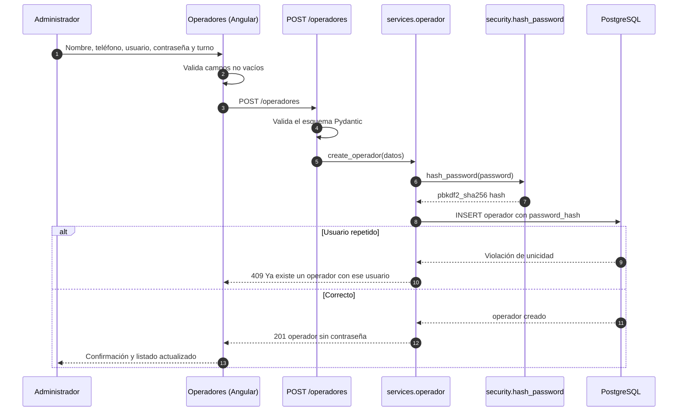

#### 7b. Gestionar operadores — editar y eliminar (RF-07, RF-17)

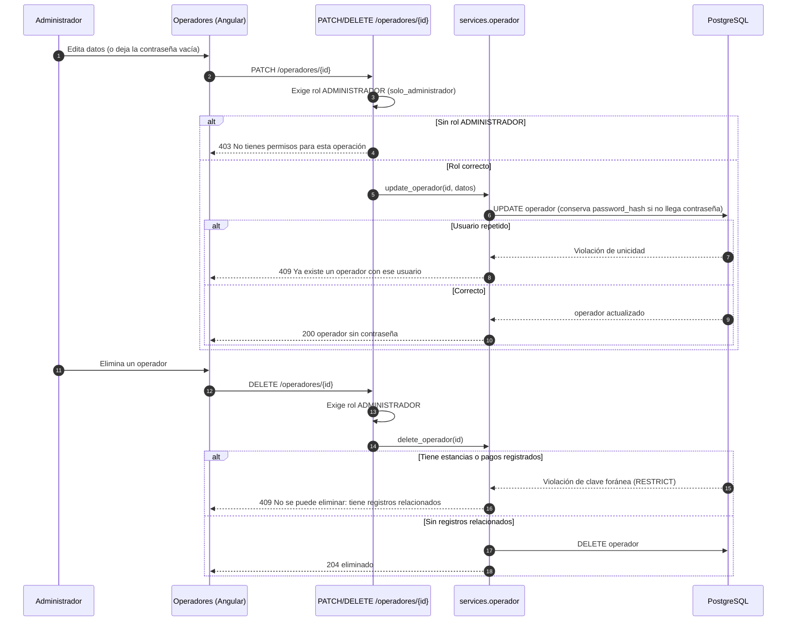

### 8. Gestionar celdas — crear y consultar disponibles (RF-06, RF-10)

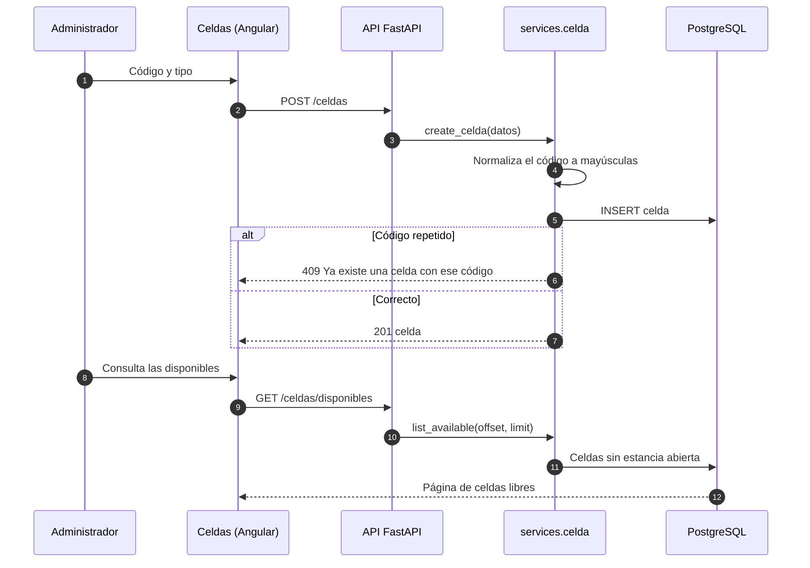

#### 8b. Gestionar celdas — editar y eliminar (RF-06, RF-17)

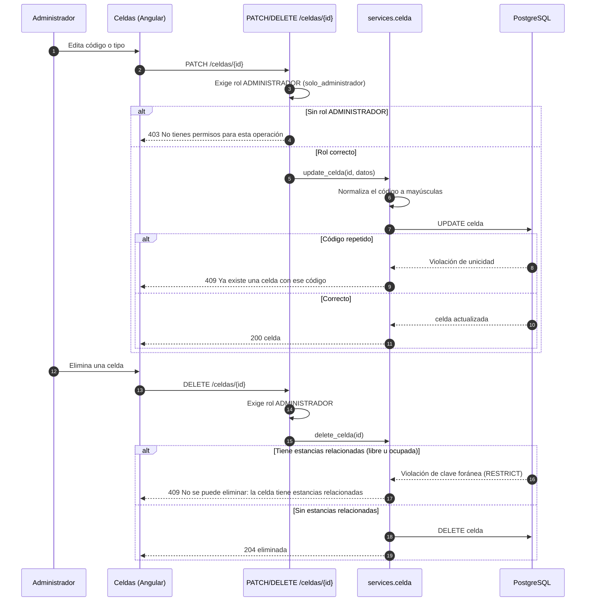

### 9. Registrar mensualidad (RF-14)

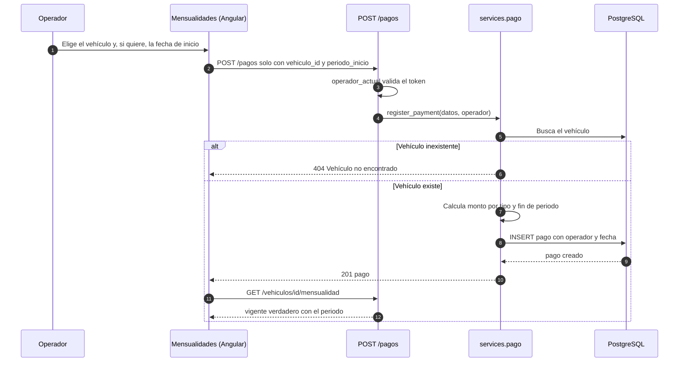

### 10. Gestionar clientes — crear y asignar vehículo (RF-12, RF-13)

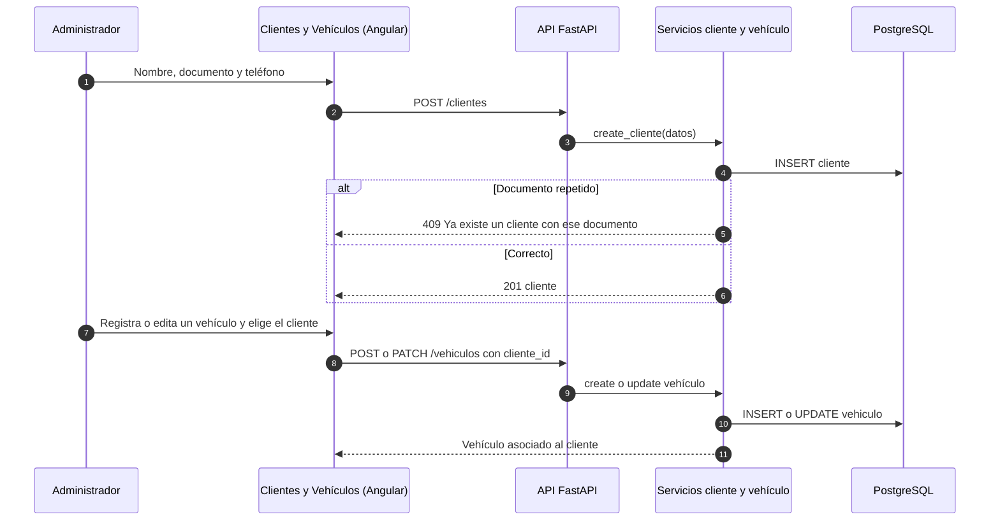

## 11. Diagrama de componentes

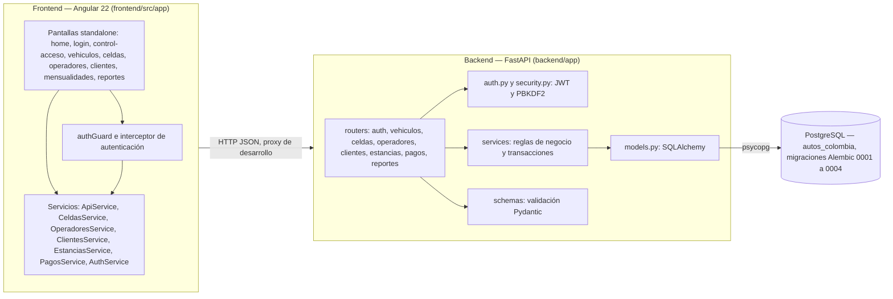

Interfaces entre componentes: el frontend solo conoce la API HTTP (rutas
relativas, base centralizada en `ApiService`); el backend no expone la
estructura de la base de datos ni errores del controlador.
